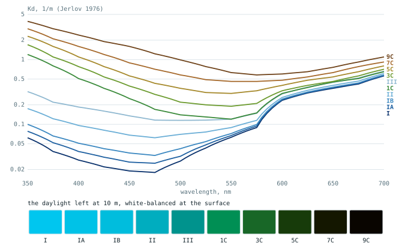

.. meta::
   :description: jerlov is a Python package of the Jerlov optical water types:
      absorption, scattering and diffuse attenuation from the papers that
      published them, with provenance, and what follows from them.

jerlov
======

The inherent optical properties of the Jerlov optical water types, with
provenance.

Jerlov's classification sorts sea water into a handful of types, from the
clearest oceanic water, type I, to turbid coastal water, 9C. This package
gives each type's absorption, scattering and diffuse attenuation from the
papers that published them, and builds on them: the light at depth, the
euphotic zone, how a coloured object looks through water, the heating of
the upper ocean, and, with a visual pigment template and a model of receptor
noise, how far apart two colours are to an eye.

      the daylight left at 10 m in each
   :width: 100%

   The ten types as Jerlov (1976) gave them: how fast daylight fades with
   depth, Kd, and the colour of what is left at 10 m, white-balanced at the
   surface and clipped to sRGB (the sun 30 degrees from the zenith, Kd
   constant with depth).
   Drawn from the package by ``tools/site_figures.py``.

Every coefficient carries the source it came from. Values that a published
table got wrong are flagged rather than quietly repaired, and quantities
that the data do not determine are refused rather than guessed.

**What is claimed.** That the published coefficients are implemented
correctly, and that every shipped table can be regenerated from its primary
source. The tests demonstrate both, by reproducing each paper's tables from
that paper's own equations.

**What is not claimed.** That this predicts what a camera will record
under water. That would need measurements which, as far as we can tell,
have not been made. DATA.md_ records what is uncertain and DECISIONS.md_
records where the model stops.

Installing
----------

.. code-block:: console

   pip install jerlov

It needs Python 3.11 or later and NumPy, nothing else.

A first calculation
-------------------

>>> import jerlov
>>> w = jerlov.water("III")    # Williamson & Hollins (2022)
>>> w
<Water III source=williamson2022 300-800 nm, a, b>
>>> print(f"at 550 nm, per metre: a {w.a(550):.4f}, "
...       f"b {w.b(550):.4f}, c {w.c(550):.4f}")
at 550 nm, per metre: a 0.0878, b 0.2870, c 0.3748

The source is part of the answer. The same type has different coefficients
in different papers, so :func:`jerlov.water` takes ``source=``, and the
:class:`jerlov.Water` it returns says where its numbers came from and what
is doubtful about them.

Two pages to look at
--------------------

- `Daylight on the way down <dive.html>`_: the colour and amount of
  sunlight left at each depth in the ten types, from 0 to 100 m.
- `Where the sources disagree <disagree.html>`_: the open questions,
  one figure each.
- `The waters side by side <waters.html>`_: every source of each type on
  one set of axes, a, b, c and Kd.

All three are made from the package's own values by ``tools/site_pages.py``
and say on the page what they assume.

Where to go next
----------------

.. toctree::
   :maxdepth: 1
   :caption: Guides

   guides/light_at_depth
   guides/euphotic_zone
   guides/colours_through_water

.. toctree::
   :maxdepth: 1
   :caption: Topics

   choosing
   topics/seeing_through_water
   topics/depth_and_light
   topics/measurements
   topics/ocean_colour
   topics/other_software
   topics/solar_heating

.. toctree::
   :maxdepth: 1
   :caption: Reference

   api
   examples
   open_questions

.. toctree::
   :maxdepth: 1
   :caption: About

   about

- What 1.0 promises to keep working until 2.0: "Compatibility" in
  CONTRIBUTING.md_.
- Every release: CHANGELOG.md_.
- Citing: the concept DOI `10.5281/zenodo.22321312
  <https://doi.org/10.5281/zenodo.22321312>`_ always resolves to the latest
  version.
